# План архитектуры и следующего этапа AI

Дата: 2026-10-29. Статус: Ollama Strategy и изолированные локальные библиотеки реализованы;
настройка и проверки — в [AI](AI.md) и [LOCAL_PROFILES](LOCAL_PROFILES.md).
Модуль contracts и воспроизводимые миграции backend реализованы. Следующий этап — границы API и жизненный цикл; перенос блокирующих операций на IO и группировка backend по функциям остаются отдельными задачами. Ниже сохранены исходные критерии плана.
Основание: [ревью](CODE_REVIEW_2026-10-29.md).

## Контекст и решение

Приложение уже разделено на Ktor backend, Kotlin Multiplatform shared и webApp.
На клиенте SQLDelight, на сервере Exposed/SQLite. Android-код существует, но Android target
выключен в Gradle. Основные рабочие платформы текущей сборки — Desktop/TUI и Web.

Сохраняем модульный монолит на Ktor. Локальная Ollama подключена через Strategy.
Облачный fallback не включаем: текст пользователя
должен оставаться в локальном окружении. Существующие Gemini/Claude/OpenAI стратегии
можно оставить как необязательные реализации, но новый сценарий от них не зависит.

| Вариант | Выгода | Цена | Решение |
| --- | --- | --- | --- |
| Ollama через backend и Strategy | Единый API для всех клиентов, общие ограничения и ошибки | Backend должен видеть локальный Ollama daemon | Выбран |
| Прямые вызовы Ollama из каждого клиента | Можно обойтись без backend для Desktop | Разные транспорты, CORS, дублирование и настройки на каждом устройстве | Отложен |
| Отдельный AI-микросервис | Независимый деплой и масштабирование | Дополнительные контракты и эксплуатация до появления нагрузки | Сейчас не нужен |

## Порядок работ

### 1. Завершить модель локальных профилей

Выполнено: отдельные DB/audio/queue/cursor, выбор библиотеки, подтверждение гостевого
связывания, стабильный AccountId и завершение старого runtime. Проверка владельца внутри
каждой библиотеки сохранена как инвариант. Неизвестная sync history не присваивается гостю.

Защитная привязка из ревью расширена стабильным AccountId и отдельными библиотеками;
одна библиотека сохраняет своего владельца, другой аккаунт использует другую библиотеку.

- Ввести `ProfileId` и `AccountId` с отдельными БД, очередью sync и курсором на профиль.
- Сделать явный переход гостевого словаря в аккаунт: показать количество записей,
  получить выбор пользователя, выполнить атомарное связывание без удаления источника.
- Добавить выбор/создание профиля в Account, опираясь на существующий recovery lifecycle.
- Останавливать и дожидаться запросов старой сессии при переключении профиля;
  ответы маркировать идентификатором сессии.
- Старые данные без JWT/владельца мигрировать отдельным сценарием, не назначать владельца автоматически.

Критерии проверены: A → logout → другая библиотека → B не передаёт записи, очередь или
курсор между аккаунтами; гостевой словарь привязывается после согласия без правки SQLite.
Проверка владельца остаётся внутри каждой библиотеки; UI позволяет создать/выбрать другую.

### 2. Реализовать Ollama Strategy — следующий этап разработки

Выполнено; далее историческое описание требований. Актуальная конфигурация поддерживается
приложением, timeout backend до 120 секунд и AI timeout shared 150 секунд, см. [AI](AI.md).

Использовать уже присутствующие `LinguisticAssistant`, `StrategyLinguisticAssistant`,
`TextGenerationStrategy` и фабрику `createLinguisticAssistant`.

```mermaid
flowchart LR
    UI[Player / Writing] --> Remote[RemoteLinguisticAssistant]
    Remote --> API[Ktor AI routes + JWT]
    API --> Cache[CachingLinguisticAssistant]
    Cache --> Tasks[StrategyLinguisticAssistant]
    Tasks --> Port[TextGenerationStrategy]
    Port --> Ollama[OllamaTextGenerationStrategy]
    Ollama --> Local[Local Ollama daemon]
```



Разделение обязанностей:

- `LinguisticAssistant` — перевод, грамматический разбор, коррекция и доменные результаты.
- `StrategyLinguisticAssistant` — промпты и проверка результатов; не знает HTTP-протокол провайдера.
- `OllamaTextGenerationStrategy` — только протокол Ollama и транспортные ошибки.
- `AiSettings`/Koin — единственное место выбора реализации, никаких `when(provider)` в UI.

Реализованная конфигурация:

```properties
AI_PROVIDER=ollama
AI_BASE_URL=http://127.0.0.1:11434
AI_MODEL=<имя уже установленной локальной модели>
```

API key для Ollama не обязателен. Дефолт `AI_PROVIDER=none` сохраняет работу приложения
без AI. При явном `ollama` недоступность daemon не должна ломать проигрывание и словарь.
Модель выбираем после оценки RAM/VRAM и качества немецкого языка на конкретной машине.
Модели не скачивать и не запускать автоматически при старте backend.

Первый транспорт: `POST /api/generate`, `stream=false`, чтение поля `response`.
Эти поля и возможность передать JSON Schema через `format` описаны в
[официальном API Ollama](https://docs.ollama.com/api/generate).
Для структурированных задач передавать схему и повторно валидировать результат,
как предусмотрено в [Structured Outputs](https://docs.ollama.com/capabilities/structured-outputs).
Для обычного перевода предложения JSON-схема не нужна.

Вместо прежнего `generate(prompt: String)` реализован `GenerationRequest(prompt, outputSchema?)`.
Ollama DTO остаются внутри адаптера; схемы TranslationResult, DeepAnalysisResult и
CorrectionResult находятся рядом с задачами, тип задачи не определяется по тексту промпта.

Ограничения и отказоустойчивость:

- Выделенный HTTP client для AI с закрытием при остановке Ktor.
- Таймауты согласованы: AI shared ждёт 150 секунд, Ollama backend — до 120.
  Обычные shared-запросы по-прежнему имеют бюджет 30 секунд.
- Ограничить длину входа, объём ответа, число генераций и ожидание в очереди.
- Сохранять отмену coroutine; не повторять генерацию автоматически без явной политики.
- Различать unavailable, timeout, overload, invalid output; отдавать безопасные сообщения.
- Проверять URI через парсер, запрещать userinfo/query/fragment в base URL;
  HTTP разрешать только для ожидаемого локального адреса. Отдельно продумать Docker,
  где localhost backend-контейнера не является хостовой Ollama.
- Ключ кэша включает задачу, модель, языки и версию промпта; не кэшировать ошибки.
- Объединять одновременные одинаковые запросы и ограничить кэш по памяти/TTL.
- Тексты из субтитров передавать как данные; ответ модели не исполнять.

Критерии приёмки Ollama:

1. Все четыре AI-операции работают через прежний HTTP API и JWT.
2. `none`, выключенная Ollama и отсутствующая модель не блокируют локальные функции.
3. MockEngine проверяет путь, отсутствие обязательного API key, `stream=false`, схемы,
   4xx/5xx, пустой/повреждённый ответ, timeout и отмену.
4. Тест двух параллельных одинаковых запросов подтверждает одну генерацию.
5. Ручной smoke на локальном daemon проверяет перевод слова в контексте,
   предложение, разбор и коррекцию; фиксируются модель, версия и время ответа.
6. Нет автоматических запросов к Gemini/Claude/OpenAI и нет prompt/token в логах.

### 3. Отделить контракт от Compose и инфраструктуры

Выполнено: `:contracts` содержит общие DTO и порт AI, `:shared` экспортирует его через `api`,
backend использует `:shared` только в интеграционных тестах. Пакеты и JSON сохранены;
Ktor-зависимый `getPlaybackUrl` и локальные типы остаются в клиенте. Группировка backend
по функциям остаётся отдельной дальнейшей работой. Ниже исходные требования.

Сейчас `backend/build.gradle.kts` зависит от всего `:shared`, включая UI и desktop зависимости.
Выделить небольшой `:contracts` с сериализуемыми HTTP DTO; `:shared` и `:backend`
зависят от него. Доменные интерфейсы переносить только там, где они действительно общие.

На backend группировать пакеты по функциям: `auth`, `sync`, `ingestion`, `media`, `ai`.
Внутри функций отделять HTTP, сценарий и адаптер хранения/внешнего процесса.
Не создавать интерфейс на каждый класс: текущие порты AI, media/process и repository
развивать по потребности тестов.

Готово, когда backend собирается без Compose/VLC/Lanterna и контрактные тесты
сохраняют совместимость клиентов.

### 4. Сделать миграции backend воспроизводимыми

Миграции выполнены: `BackendDatabase` применяет V1–V3 SQL с checksum-историей,
проверяет известные legacy-схемы, создаёт уникальный SQLite backup и откатывает весь
upgrade при ошибке. Повторный startup не переписывает курсоры. Bootstrap запускается
до HTTP clients/workers. [Версии и восстановление](BACKEND_MIGRATIONS.md).
Перенос JDBC/BCrypt на подходящие диспетчеры ещё требует отдельного изменения.
Далее исходные требования.

`BackendModule.kt` выполняет `createMissingTablesAndColumns` и преобразование cursor при старте.
Перейти к нумерованным SQLite-миграциям с таблицей версии, проверкой схемы и backup policy.
SQLDelight миграции клиента оставить отдельным механизмом.

Добавить fixtures старой backend БД и тест upgrade/restart. Разделить bootstrap БД,
создание HTTP clients и DI wiring. JDBC/BCrypt выполнять на подходящих диспетчерах,
не удерживая потоки обработки сетевых запросов на длительных операциях.

### 5. Уточнить границы API и жизненный цикл

Шесть направлений разбиты на спринты NEXT-1–NEXT-6 в [плане спринтов](todo.md).
NEXT-3a (индикаторы Player) и NEXT-1 (HTTP-лимиты/валидация и совместимый пакетный sync)
реализованы. [Пределы API](API_LIMITS.md). Следующий этап — NEXT-2: диспетчеры backend.
Публичный режим и занятие с участником имеют отдельные критерии и зависимости.

- Ввести явные ошибки валидации вместо общего `IllegalArgumentException` на HTTP-границе.
- Задать лимиты sync batch, AI-текста и тела auth-запроса до десериализации/хэширования.
- Решить режим public ingestion/media: локальный инструмент либо размещаемый сервис;
  для второго режима добавить права на job/media и защиту auth от перебора.
- Сохранить добавленное в ревью ограничение bearer token backend origin;
  при развитии загрузчика разделить backend API client и клиент внешних ресурсов.
- Разделить «провайдер настроен» и «сейчас доступен» в capabilities, предусмотреть повторную проверку UI.
- В Player заменить одиночные loading ID для независимых строк набором активных запросов.
- При остановке завершать фоновые workers и закрывать HTTP clients/DB handles предсказуемо.

Готово, когда проверены отмена, остановка приложения, 400/401/403/503 и отсутствие утечки
credentials/внутренних исключений; существующие media budget/recovery тесты остаются зелёными.

## Очерёдность поставки

Отдельные небольшие изменения: (1) текущее ревью с багфиксами; (2) запрос генерации +
Ollama Strategy и её тесты; (3) локальный smoke и документация запуска;
(4) полноценные профили/гостевая миграция; (5) contracts и backend migrations.
Внутри одной библиотеки смена владельца запрещена; multi-account работает через выбор библиотеки.
Микросервисы, CQRS и смена Ktor
для следующего этапа не требуются.
