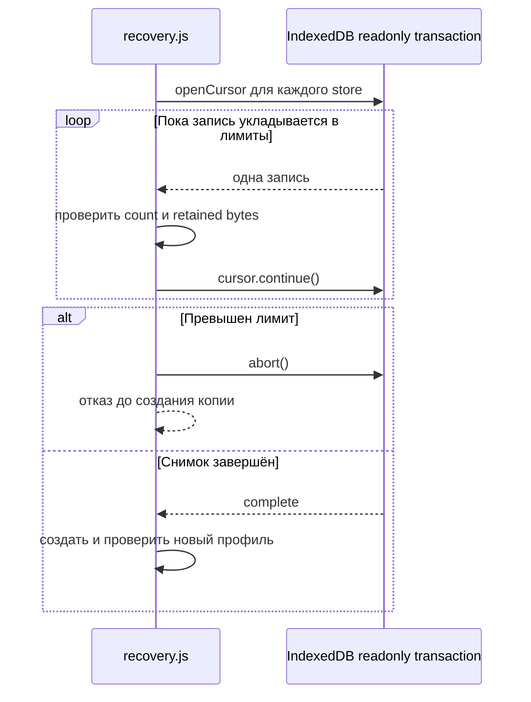
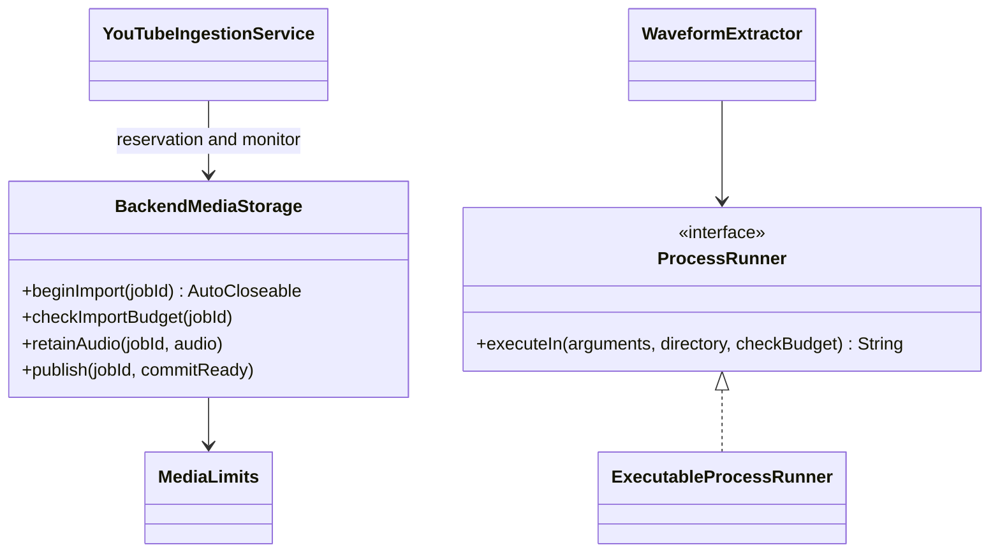
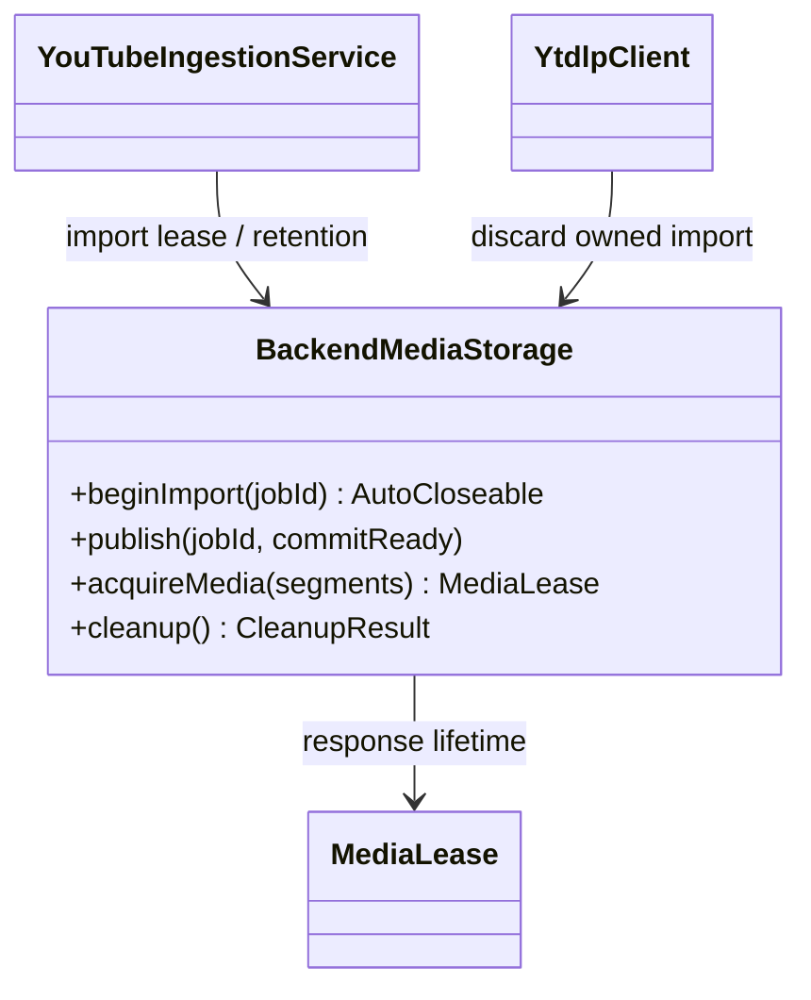
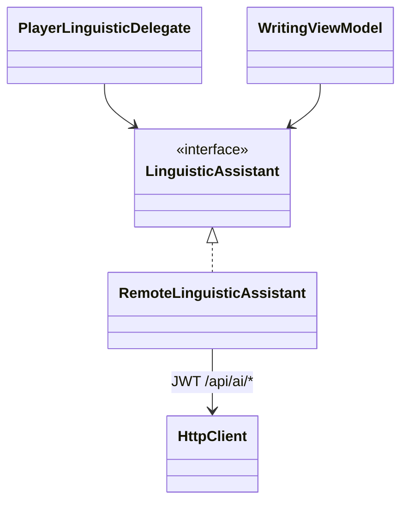

# REL-15 — 2026-10-22 — ограниченное чтение Web recovery

Доменные классы и публичные контракты не менялись. Существующий инфраструктурный модуль `recovery.js` заменяет массовое чтение store последовательным курсором; отдельный GoF-паттерн не вводится.



# REL-14 — 2026-10-22 — backend media budget



Расширен существующий **lease**-протокол, новые GoF-иерархии не вводятся. BackendMediaStorage сериализует admission/бюджет/retention; MediaLimits — неизменяемая конфигурация. Сервис владеет coroutineScope обработки и монитора, runner вызывает checkBudget и reap известных потомков. PCM/logs принадлежат job-каталогу. Схема БД не менялась. [ADR](ADR_BACKEND_MEDIA_BUDGET.md).

# REL-13 — 2026-10-22 — backend media lifecycle



BackendModule разделяет один BackendMediaStorage между импортом и HTTP MediaRoutes. Это lifecycle-координация через **lease** и monitor, без новой GoF-иерархии. Durable marker подтверждает владение UUID-каталогом при повторяемой уборке; публикация ready и callback READY в БД предшествуют открытию читателей. Прежний DownloadCleanup удалён как неподключённая утилита. Схема БД не менялась; cleanup IngestionJobs сохраняет активные состояния. TTL выключен по умолчанию, квоты с резервированием ещё не реализованы. [ADR](ADR_BACKEND_MEDIA_RETENTION.md), [актуальная карта](UML_CLASSES.md).

# REL-12 — 2026-10-22 — удалённый AI Adapter



`commonModule` выбирает `RemoteLinguisticAssistant`, **Adapter** существующего порта к HTTP backend. BackendModule сохраняет **Strategy** Gemini/mock и **Decorator** CachingLinguisticAssistant; клиент не получает ключ Gemini. Общие `TranslateRequest`, `TextRequest`, `SentenceTranslationResult` связывают четыре маршрута и адаптер, включая новый перевод реплики. WritingViewModel владеет Job/поколением коррекции для отмены и защиты от позднего ответа. Актуальная карта — [UML_CLASSES](UML_CLASSES.md).

# REL-11 — 2026-10-22 — выпуск без изменений архитектуры

```text
+---------------------------+   PR #6, merge   +-----------------------------+
| sprint/rel-s3-multitab     |---------------->| dev: REL-S2 + REL-S3        |
| LK-04, reviewed + CI      |                 | release candidate + CI      |
+---------------------------+                 +--------------+--------------+
                                                            | release PR + CI
                                             +--------------v--------------+
                                             | main: ordinary merge        |
                                             | retain both histories       |
                                             +--------------+--------------+
                                                            | fast-forward dev
                                             +--------------v--------------+
                                             | main/dev: same tree and HEAD |
                                             | remove merged sprint only   |
                                             +-----------------------------+
```

Это схема выпуска Git, не новая UML-модель классов. Runtime, **Adapter**, **Observer** и lifecycle lease-протоколы не меняются; актуальная схема LK-04 находится в REL-10 ниже.

В release CI уточнена синхронизация тестов после закрытия владельца: Promise-предикат waitForFunction → явный await/poll page.evaluate → фактическая операция с ограниченным ожиданием. Добавлена управляемая задержка shared lease; проверки живого владельца остаются fail-fast. async-wait.js — функция тестовой инфраструктуры, новых классов/паттернов и изменений runtime нет.

# REL-10 — 2026-10-22 — LK-04, Observer между вкладками

```text
+---------------------------+        notifies        +-----------------------------+
| BrowserSqlDriver A        |----------------------->| database-events.js          |
| SQLDelight <<Adapter>>    | after commit / notify  | profile BroadcastChannel    |
+---------------------------+                        +--------------+--------------+
                                                                   | committed hint
+---------------------------+     invalidates         +-------------v---------------+
| BrowserSqlDriver B        |<------------------------| DatabaseClient B            |
| Query.Listener <<Observer>>|                        | focus / pageshow / visible  |
+-------------+-------------+                         +-----------------------------+
              | queryResultsChanged (no SQL / no echo)
+-------------v-------------+       acquires          +-----------------------------+
| repository Flow          |------------------------>| DatabaseAccess mutex        |
| local subscriptions      |                         | then SQLite read            |
+---------------------------+                         +-----------------------------+
```

Расширен существующий **Observer** SQLDelight через инфраструктурный канал уведомлений. BrowserSqlDriver сохраняет роль **Adapter**, repository/database границы не меняются. Входящие hints объединяются до конца локальной транзакции; rollback не публикуется. Канал — подсказка перечитать данные, не журнал синхронизации и не distributed lock. Lifecycle leases recovery-v2 остаются отдельным протоколом.

# REL-09 — 2026-10-22 — lifecycle recovery-v2

```text
+------------------------+  shared lease  +-----------------------------------+
| database.worker.js     |--------------->| profile-lifecycle.js <<JS module>> |
| SQLite connection     |                | acquire / withProfileLease        |
+------------------------+                | removeWebRecoveryProfile          |
+------------------------+  shared lease  |                                   |
| index.js: audio page   |--------------->| Web Locks: shared / exclusive     |
+------------------------+                +-----------------+-----------------+
+------------------------+  shared lease                    | strict transactions
| recovery.js: snapshots |----------------+                 v
| clone / export / import|                |  +--------------------------------+
+------------------------+                |  | Profile registry <<states>>    |
                                         |  | active -> deleting -> deleted  |
+------------------------+ exclusive     |  +----------------+---------------+
| recovery-page.js       |---------------+                   | clear records
| confirm / retry removal|                                   v
+------------------------+                +-----------------------------------+
                                          | SQLite blocks + audio/chunks      |
                                          | no deleteDatabase; containers stay|
                                          +-----------------------------------+
```

Это модульные функции и протокол shared/exclusive lease с реестром состояний, новые GoF-классы не вводятся. Существующие VFS **Adapter** не меняются. Download/content leases сохраняют отдельные границы. Tombstone перед очисткой делает операцию повторяемой после частичного отказа; общей транзакции двух БД нет. Старые ID не удаляются, v2 отвергается прежними сборками.

# REL-08 — 2026-10-22 — инвентаризация recovery-профилей

```text
+---------------------------+       calls       +---------------------------------+
| recovery-page.js          |------------------>| recovery.js <<JS module>>       |
| refresh / select source   |                   | listWebRecoveryProfiles()       |
+---------------------------+                   +----------------+----------------+
                                                                | enumerates only
                                               +----------------v----------------+
                                               | IndexedDB.databases()           |
                                               | names; no open / upgrade / delete|
                                               +---------------------------------+
```

Это функции существующих JS-модулей, новый GoF-паттерн не вводится. Основной профиль исключён; неполные копии видны без открытия. Существующие VFS Adapter и протоколы download lease не менялись. Общий lifetime-lock профиля для безопасного удаления ещё не реализован.

# REL-07 — 2026-10-22 — Web recovery: profile namespaces и компактный архив

```text
+--------------------------+       calls       +----------------------------------+
| recovery-page.js         |------------------>| recovery.js <<JS module>>        |
| separate DOM entry       |                   | clone / export / import functions |
+--------------------------+                   +--------+-------------------------+
                                                       | readonly snapshots
+--------------------------+                           |
| Original IndexedDB       |---------------------------+
| VFS v5 + audio v1        |                           | new UUID profile only
+--------------------------+                           v
                                      +----------------------------------+
                                      | database.worker.js               |
                                      | repair SQL copy / quick_check    |
                                      +---------------+------------------+
                                                      | uses
                                      +---------------v------------------+
                                      | IDBBatchAtomicVFS <<Adapter>>     |
                                      | isolated DB + short SQLite file  |
                                      +---------------+------------------+
                                                      | VACUUM INTO
                                      +---------------v------------------+
                                      | MemoryVFS <<Adapter>>            |
                                      | compact live SQLite pages        |
                                      +---------------+------------------+
                                                      v
                                      JSON archive <----> NEW profile

profile.js -> DB names + SQLite file + download lock namespace
default URL -> historical profile; ?profile=recovered-UUID -> isolated copy
```

Классы VFS принадлежат существующей wa-sqlite. Recovery/page/profile — JS-модули с функциями, без новой доменной иерархии или GoF-паттерна. Архив не содержит истории raw VFS; SQL/audio не образуют общего атомарного снимка. Исходник сохраняется, незавершённая копия не получает ссылку. [Ограничения и запуск](LEGACY_RECOVERY.md).

# REL-06 — 2026-10-22 — legacy recovery в изолированный профиль

```text
+-----------------------------------------+
| recover_legacy_profile <<Python module>> |
| audit_profile / clone_profile            |
+-------------------+---------------------+
                    | read-only SQL
                    v
+-------------------------+       backup snapshot      +------------------------+
| Original client profile |--------------------------->| Preparing profile      |
| DB + managed audio      |                            | DB + stable audio copy |
+-------------------------+                            +------------+-----------+
                                                                   | validate
                                                      +------------v-----------+
                                                      | New recovered profile  |
                                                      | rewritten paths/status |
                                                      | auth cleared + report  |
                                                      +------------------------+

RecoveryError <|-- UnavailableAudio
unknown ownership -> preserve original; repair status only inside isolated snapshot
failed preparation -> retain preparing directory; destination not published
```

Это операционная Python-утилита, а не новый слой Kotlin-приложения. SQLite backup и файловое копирование — адаптация инфраструктуры к recovery-сценарию; новые GoF-паттерны не вводились. Изоляция профилей заменяет недоказуемое определение смерти старого владельца. [Руководство](LEGACY_RECOVERY.md).

# REL-05 — 2026-10-22 — файловый Decorator и replay-журнал

```text
+---------------------------+             +----------------------------+
| AudioDownloaderImpl       |-----uses---->| AudioStorage <<Port>>      |
| SQL link -> confirmLinked |             +--------------+-------------+
+---------------------------+                            ^ implements
                                         +--------------+-------------+
+---------------------------+            | JournaledFileAudioStorage  |
| PendingAudioRecovery      |---uses----->| <<Decorator + Adapter>>    |
| free lease + ALL SQL refs  |   via       | pending sidecar / resolve  |
+---------------------------+ PendingPort +--------------+-------------+
                                                        | delegates
                                         +--------------v-------------+
                                         | FileAudioStorage           |
                                         | beforeWrite -> journal     |
                                         | stream -> .part -> .mp3    |
                                         +----------------------------+

native content lease -> force journal -> create .part -> publish MP3
SQL COMMIT -> confirmLinked -> remove journal
crash -> free lease -> SQL refs? keep + confirm : delete payload then journal
partial cleanup failure -> journal remains -> replay on next startup
```

JournaledFileAudioStorage реализует оба порта AudioStorage/PendingAudioStorage и декорирует потоковый FileAudioStorage. Журнал — долговечная запись незавершённой передачи владения. В IndexedDB используется транзакция, в файловой системе — проверяемое идемпотентное повторение с удалением журнала последним; распределённой транзакции с SQLite нет.

# REL-04 — 2026-10-22 — Desktop/TUI: platform lease

```text
+-------------------------+                  +--------------------------+
| AudioDownloaderImpl     |------uses-------->| AudioDownloadCoordinator |
| AudioDownloadRecovery   |                  | <<Platform Port>>        |
+------------+------------+                  +-------------+------------+
             | SQL + protocol                              ^ implements
             v                              +-------------+------------+
+-------------------------+                 | FileAudioDownloadCoordinator|
| DatabaseAccess          |                 | <<JVM Adapter>>          |
| Content + SyncMetadata  |                 | JVM claimed registry     |
+-------------------------+                 | FileChannel / FileLock   |
                                            +-------------+------------+
                                                          | owns
                                            +-------------v------------+
                                            | AudioDownloadLease       |
                                            | jvm-file-lock-v1         |
                                            | idempotent release       |
                                            +--------------------------+

DesktopModule -> same profile / download-locks -> downloader + DB startup recovery
active OS lock -> preserve DOWNLOADING
free OS lock + known SQL marker -> ERROR / COMPLETED with old path
```

Порт и общий Application Service сохранены; Java NIO — платформенный Adapter. Взаимное исключение внутри JVM дополняет кооперативный межпроцессный lock. Schema/Repository не изменялись. Уборка файлов после аварии потребует отдельного pending-журнала, текущий фикс восстанавливает SQL-статус.

# REL-03 — 2026-10-22 — pending-публикация и проверка SQL-ссылок

```text
+-------------------------+     after SQL COMMIT     +--------------------------+
| AudioDownloaderImpl     |------------------------->| AudioStorage             |
| <<Application Service>> |                          | confirmLinked(location)  |
+-------------------------+                          +-------------+------------+
                                                                  ^ implements
+-------------------------+     uses                 +-------------+------------+
| PendingAudioRecovery    |------------------------->| IndexedDbAudioStorage    |
| <<Application Service>> |                          | <<Platform Adapter>>     |
| recover()               |                          | pending list / resolve   |
+------------+------------+                          +-------------+------------+
             | uses                                               ^ implements
       +-----+-----------------------+               +-------------+------------+
       v                             v               | PendingAudioStorage      |
+---------------------+ +-------------------------+  | <<Recovery Port>>        |
| DatabaseAccess      | | AudioDownloadCoordinator|  +--------------------------+
| ALL Content refs    | | full content lease      |
+---------------------+ +-------------------------+

published pending -> SQL link -> confirmLinked -> confirmed (outside pending GC)
closed owner -> free lease -> SQL refs? yes: confirm / no: delete manifest+chunks
SQL read failed / active owner / unknown protocol -> preserve
```

Сохранены Ports/Adapters и компенсация. Долговечная pending-метка фиксирует незавершённую передачу владения между двумя хранилищами; это не распределённая транзакция. Проверка SQL проходит под DatabaseAccess и content lease; атомарное удаление ограничено IndexedDB. [Решение и точки аварии](ADR_AUDIO_DOWNLOAD_RECOVERY.md).

# REL-02 — 2026-10-22 — согласование SQL-статуса и владельца

```text
+-------------------------+      uses      +--------------------------------+
| AudioDownloaderImpl     |--------------->| AudioDownloadCoordinator       |
| <<Application Service>> |                | <<Platform Port>>              |
+------------+------------+                | tryAcquire(contentId) -> lease |
             |                            +---------------+----------------+
             | SQL + marker                               ^ implements
             v                            +---------------+----------------+
+-------------------------+               | WebAudioDownloadCoordinator    |
| DatabaseAccess          |<----------+    | <<Adapter>>                    |
| AppDatabase transaction |           |    | content Web Lock              |
| Content + SyncMetadata  |           |    +--------------------------------+
+-------------------------+           |          ^ uses
                                      |          |
                           +----------+----------+-------------+
                           | AudioDownloadRecovery              |
                           | <<Application Service>>            |
                           | free lease + known marker          |
                           | recheck SQL -> restore status      |
                           +------------------------------------+

lease held: DOWNLOADING + marker -> HTTP -> asset -> SQL link + remove marker
crash: free lease + marker -> ERROR (no old path) / COMPLETED (old path kept)
active lease / unknown marker / no coordination -> preserve
```

Ports/Adapters отделяют браузерную синхронизацию от общего downloader. UncoordinatedAudioDownloads сохраняет поведение платформ без реализации lease. Изменение статуса и метки образует одну SQLite-транзакцию; отдельная asset-блокировка REL-01 защищает manifest/chunks. [Решение и ограничения](ADR_AUDIO_DOWNLOAD_RECOVERY.md).

# REL-01 — 2026-10-22 — LK-03: lifetime lock и уборка

```text
+-------------------------+       calls       +---------------------------+
| IndexedDbAudioStorage   |------------------>| storage/index.js          |
| <<Platform Adapter>>    |                   | <<JS module>>             |
| store / delete          |                   | begin / append / commit   |
+-------------------------+                   | abort / recoverIncomplete |
                                              +-------------+-------------+
                                                            | coordinates
                                              +-------------v-------------+
                                              | Web Locks <<Browser API>> |
                                              | exclusive lock per asset  |
                                              +-------------+-------------+
                                                            | protects
                                              +-------------v-------------+
                                              | IndexedDB audio + chunks  |
                                              | <<Transactional Store>>   |
                                              +---------------------------+

begin -> hold lock -> append* -> commit/abort -> release lock
closed owner -> free lock -> recheck incomplete -> atomic manifest+chunks delete
active owner / complete / legacy / no-lock -> preserve
```

Порт/адаптер AudioStorage сохранён. Web Locks — механизм взаимного исключения владельца и уборщика; удаление manifest/chunks атомарно в пределах IndexedDB. Это не транзакция с SQLite. Уборка запускается из WebDatabaseFactory и beginAudio; SQL recovery и сбор готовых непривязанных объектов остаются отдельной задачей.

# INT-11 — 2026-10-22 — LK-02: передача владения и компенсация

```text
+--------------------------+         uses         +-------------------------+
| AudioDownloaderImpl      |--------------------->| AudioStorage <<Port>>   |
| <<Application Service>>  |                      | store / delete          |
| previous / location      |                      +------------+------------+
| linked                   |                                   ^ implements
+-------------+------------+                     +-------------+-------------+
              |                                  | FileAudioStorage          |
              | serialized by                    | IndexedDbAudioStorage     |
              v                                  | <<Platform Adapters>>     |
+--------------------------+                     +---------------------------+
| DatabaseAccess           |
| run under shared mutex   |      checks          +---------------------------+
|                         |--------------------->| AppDatabase (generated)   |
+--------------------------+                     | Content localAudioPath    |
                                                +---------------------------+

Ownership: storage --successful return--> downloader --SQL link--> database
Failure:   check persisted references --unbound only--> compensating delete
```

Порты/адаптеры и Repository сохранены; компенсация — механизм согласования двух хранилищ. Исключение возврата после COMMIT не отменяет владение БД. Crash recovery остаётся отдельной задачей. Полная текущая UML-карта: [UML_CLASSES](UML_CLASSES.md), паттерны и модули: [DEVELOPER_GUIDE](DEVELOPER_GUIDE.md).

# INT-10 — 2026-10-22 — итоговая интеграция

```text
+-------------------------+       delegates       +---------------------------+
| MainApp / PlayerVM      |----------------------->| LinguisticAssistant       |
| <<Presentation Model>>  |                        | <<Strategy + Decorator>>  |
+------------+------------+                        +---------------------------+
             | uses
       +-----+------------------------+
       v                              v
+-----------------------+   +-----------------------------+
| AudioPlayer           |   | LocalContentRepository      |
| <<Bridge>>            |   | VocabularyRepository        |
| Web / VLC / ffplay    |   | <<Repository>>              |
+-----------------------+   +---------------+-------------+
                                            | implemented by
                                            v
                            +-----------------------------+
                            | SQLDelight + DatabaseAccess |
                            | SQLite JDBC / WASM worker   |
                            +-----------------------------+
```

Эти контракты сохранены при dev → main. Новых паттернов в завершающем коммите документации нет. Архитектура и границы проверок описаны в INTEGRATION_COMPLETION.md; незавершённые внешние проверки остаются в backlog.

# INT-09 — 2026-10-22

```text
+-------------------------+  normalizes  +-----------------------+
| browser-locale.js       |------------>| navigator locale tags |
| <<Compatibility Layer>> |             | POSIX -> BCP-47       |
+-------------+-----------+             +-----------------------+
              | before
              v
+-------------------------+
| Compose / Intl.Locale   |
+-------------------------+
```

Адаптер окружения выполняется до запуска Compose; новых доменных классов или GoF-паттернов не добавлено. Нормальные языковые предпочтения сохраняются, некорректные не останавливают рендеринг.

# INT-08 — 2026-10-22

```text
+----------------------+       depends on       +----------------------------+
| Common VM/Repository |----------------------->| coroutines-core 1.8.0      |
+----------------------+                        +-------------+--------------+
                                                            ^ same ABI
+----------------------+       uses             +-------------+--------------+
| Kotlin/JS regression |----------------------->| coroutines-test 1.8.0      |
| <<Test Fixture>>     |                        +----------------------------+
+----------------------+
```

Новых GoF-паттернов нет: исправлена бинарная совместимость тестового runtime с зависимостью Compose. Проверка работает в Chromium и CI.

# INT-07 — 2026-10-22

```text
+--------------------------+     delegates     +---------------------------+
| PlayerViewModel          |------------------>| PlayerLinguisticDelegate  |
| <<Presentation Model>>   |                   | selectionGeneration       |
| loadGeneration           |                   | wordJob / content epoch   |
| audioRequest / save guard|                   | dismiss / retry / reset   |
+------------+-------------+                   +-------------+-------------+
             | uses                                          | uses
             v                                               v
+--------------------------+                   +---------------------------+
| AudioPlayer <<Bridge>>   |                   | LinguisticAssistant       |
| load(url, requestId)     |                   | <<Strategy>>              |
| error(requestId, reason) |                   +---------------------------+
+------------+-------------+
             ^ implements
      +------+------------------+
      | Web / VLC / ffplay      |
      +-------------------------+

+--------------------------------------+     implements     +----------------------+
| SqlDelightVocabularyRepository        |------------------->| VocabularyRepository |
| <<Repository>>                       |                    +----------------------+
| reviewClock + SQL query observations |
| pending revision + acknowledgement   |
+--------------------------------------+
```

Делегирование сохраняет расширенные функции dev. Поколение запроса ограничивает область применения асинхронного результата; это механизм согласованности, а не отдельный GoF-паттерн. Контракт AudioPlayer отделяет платформенные движки, Repository — хранение и sync от UI.

# UML changelog

## INT-05 — 2026-10-22 — данные и Web

```text
+---------------------------+     +---------------------------+
| Content/Vocabulary Repo   |---->| DatabaseAccess            |
| Repository                |     | Mutex + async operations  |
+---------------------------+     +-------------+-------------+
                                                | owns access
                                  +-------------v-------------+
                                  | DatabaseHandle/AppDatabase|
                                  +-------------+-------------+
                                                | SqlDriver Adapter
                           +--------------------+------------------+
                           v                                       v
              +-------------------------+           +-------------------------+
              | PersistentJdbcDriver    |           | BrowserSqlDriver        |
              | owned JDBC connection   |           | Worker + SQLite WASM    |
              +-------------------------+           +-------------------------+

+---------------------------+     +---------------------------+
| AudioDownloaderImpl       |---->| <<AudioStorage>>          |
| response validation       |     | store / delete            |
+---------------------------+     +-------------+-------------+
                                  FileAudioStorage / IndexedDB

MainApp (common UI) --> platform DI --> Repository / AudioPlayer
```

Сохранены Repository и платформенные Adapter. Мигратор распознаёт схемы двух веток; Data Access сериализует работу соединения. Flow уведомляет UI, роли SRS не меняются.

## INT-06 — 2026-10-22 — auth и sync

```text
AccountView --> UserSession --> HttpClient (JWT)
                    |              |
                    v              v
               SyncMetadata    AuthService --> UserRepository

SyncManager --> VocabularyRepository --> SyncService
                 offline queue            |
                 revision ack              v
                               BackendVocabularyRepository
                               server cursor + tombstones
```

Сохраняется Repository; offline queue и tombstones реализуют надёжную передачу изменений. Теги сериализуются без потери запятых. Новая правка не подтверждается ответом на старый запрос. Общий UI использует Koin core без несовместимой Compose-обёртки.

## INT-04 — 2026-10-21 — аудио, отмена и ограниченный импорт

```text
+-------------------------+          +-------------------------+
| YouTubeIngestionService |--------->| IngestionJobRepository  |
| startIngestion / close  |          | Repository              |
| bounded admission      |          +-------------------------+
| Channel + workers      |
+--------+----------------+
         | uses                             uses
         +-----------------------------+---------------------+
         v                             v                     v
+------------------+        +--------------------+  +-------------------+
| YtdlpClient      |        | WaveformExtractor  |  | SrtParser         |
| CLI Adapter      |        | extract: 200 bins  |  | SRT/VTT validation|
+--------+---------+        +----------+---------+  +-------------------+
         | uses                        | uses
         +--------------+--------------+
                        v
              +------------------------+
              | <<ProcessRunner>>      |
              | execute(args): String  |
              +-----------+------------+
                          ^ implements
              +-----------+------------+
              | ExecutableProcessRunner|
              | timeout / cancel / reap|
              +-----------+------------+
                          | ProcessBuilder Adapter
                          v
                    yt-dlp / ffmpeg

+----------------------+    +-----------------------+
| AudioDownloaderImpl  |--->| HttpClient / FileSystem|
| HTTP/MIME/size guard |    +-----------------------+
| cancellation cleanup|
+----------------------+
```

Сохраняется Repository, CLI доступ оформлен Adapter с заменяемым ProcessRunner для испытаний. Очередь с воркерами реализует Producer–Consumer (конкурентный шаблон, не новый GoF-класс). CancellationException пробрасывается через use case, sync и offline delegate. Схема БД, SRS и протокол синхронизации в INT-04 не менялись.

## INT-03 — 2026-10-21 — платформенный dispatcher и baseline

```text
+----------------------+       +-----------------------------+
| SyncManager          |------>| ioDispatcher (expect val)   |
| sync(force)          |       +--------------+--------------+
+----------+-----------+                      | actual
           | uses                   +---------+----------+
           v                        |                    |
+----------------------+   +--------v---------+ +--------v---------+
| VocabularyRepository |   | Desktop/Android  | | JS               |
| Repository pattern   |   | Dispatchers.IO   | | Dispatchers.Default |
+----------------------+   +------------------+ +------------------+

+----------------------+       +-----------------------------+
| PlayerViewModel      |------>| kotlinx.datetime.Clock      |
| scroll timeout       |       | System.now()                |
+----------------------+       +-----------------------------+
```

Сохраняется Repository; платформенные детали вынесены через существующий механизм expect/actual. Это свойство, а не новый класс или отдельный GoF-шаблон. Тестовые репозитории используют отдельные временные SQLite-файлы на каждый тест. Production-схема и контракты Repository не изменены.

## INT-02 — 2026-10-21 — статус проекта в README

Изменена только документация. Диаграмма классов и применяемые Repository/Adapter остаются такими, как зафиксировано в INT-01; новые классы и шаблоны не добавлялись. README связывает найденные проблемы Web DI/хранилища, импорта и репозиториев с этапами стабилизации.

## INT-01 — 2026-10-21 — аудит интеграции

Зафиксирована существующая структура dev; реализация классов не менялась. План интеграции: `INTEGRATION_PLAN_2026-10-21.md`.

```text
+---------------------------+       +-------------------------+
| YouTubeIngestionService   |------>| IngestionJobRepository  |
| startIngestion(url): id   |       | save / update / cleanup |
+-------------+-------------+       +-------------------------+
              | uses                        Repository
              v
+---------------------------+
| YtdlpClient               |  Adapter к внешнему CLI
| getVideoInfo / download   |
+---------------------------+

+---------------------------+       +-------------------------+
| PlayerViewModel           |------>| <<AudioPlayer>>         |
| presentation state       |       +------------+------------+
+---------------------------+                    ^ implements
                                    +------------+------------+
                                    | VLC / FFmpeg / Browser   |
                                    +-------------------------+
                                     платформенные реализации

+---------------------------+       +-------------------------+
| LocalContentRepository    |<......| SqlDelightContentRepo   |
+---------------------------+       +------------+------------+
             Repository                          | uses
                                                 v
                                    +-------------------------+
                                    | AppDatabase             |
                                    +-------------------------+
```

Сохраняются Repository и Adapter, внедрение зависимостей Koin. Разные реализации AudioPlayer используют общий интерфейс; выбор зависит от платформы. Планируемые ограничения очереди, миграции и async Web-доступ ещё не реализованы и не обозначаются как выполненные шаблоны.
