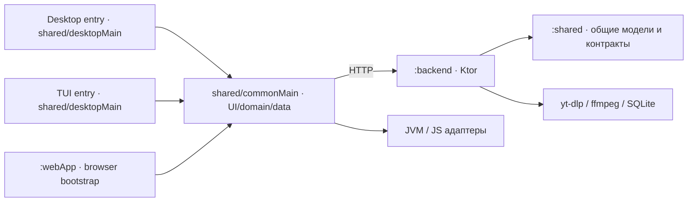

# Руководство разработчика Langkraft

Документ описывает текущий код после интеграции dev/main и исправления LK-02. Инструкции окружения — [RUNNING](RUNNING.md), классы и связи — [UML_CLASSES](UML_CLASSES.md), история — [CHANGELOG](CHANGELOG.md). Здесь описана структура существующего Kotlin/Ktor/Compose приложения.

## Модули и точки входа

В [settings.gradle.kts](../settings.gradle.kts) подключены три Gradle-модуля:

| Модуль | Ответственность | Точки входа / конфигурация |
| --- | --- | --- |
| `:shared` | Модели, SRS, UI, use case, repository, sync, платформенные адаптеры; JVM Desktop/TUI и JS target | [Koin.kt](../shared/src/commonMain/kotlin/com/langkraft/di/Koin.kt), [main.kt](../shared/src/desktopMain/kotlin/com/langkraft/main.kt), [CliMain.kt](../shared/src/desktopMain/kotlin/com/langkraft/CliMain.kt) |
| `:backend` | Ktor HTTP API, auth/JWT, Exposed/SQLite, задания импорта, yt-dlp/ffmpeg, AI API | [Application.kt](../backend/src/main/kotlin/com/langkraft/backend/Application.kt), [Routing.kt](../backend/src/main/kotlin/com/langkraft/backend/Routing.kt), [BackendModule.kt](../backend/src/main/kotlin/com/langkraft/backend/di/BackendModule.kt) |
| `:webApp` | Browser bootstrap, CanvasBasedWindow, HTML, ресурсы, dev proxy; использует общий UI | [Main.kt](../webApp/src/jsMain/kotlin/Main.kt), [index.html](../webApp/src/jsMain/resources/index.html), [dev-server.js](../webApp/webpack.config.d/dev-server.js) |

Зависимость Gradle backend → shared не создаёт HTTP-цикл: runtime-клиенты обращаются к backend по сети, backend использует общие типы. Сейчас shared также содержит UI, поэтому backend получает больше зависимостей, чем чистый отдельный domain-модуль.

Desktop и TUI — два main в `shared`, а не отдельные Gradle-модули. `androidApp` и `shared/src/androidMain` сохранены как исходники, но Android target отключён и androidApp не включён в settings. Флаги из исторических документов не включают Android автоматически.

## Source sets и слои shared

| Каталог | Содержимое и границы |
| --- | --- |
| `src/commonMain/.../domain/model` | Serializable модели контента, субтитров, словаря, auth, sync и jobs |
| `domain/repository` | Порты LocalContentRepository, RemoteContentSource, AudioDownloader, VocabularyRepository |
| `domain/usecase`, `domain/srs`, `domain/ai` | IngestContentUseCase, стратегия SM-2, контракт LinguisticAssistant и mock |
| `data/repository`, `data/sync` | SQLDelight/HTTP реализации, очередь sync, UserSession, SyncManager |
| `data/database`, `data/audio` | Владение БД, общий DatabaseAccess, миграции, контракт потокового AudioStorage |
| `ui` | Compose представления, StateViewModel, состояния/события, делегаты Player |
| `di` | commonModule и AppConfig: сборка зависимостей приложения |
| `src/commonMain/sqldelight` | SQL-схема, запросы и миграции; AppDatabase генерируется, не редактируется вручную |
| `src/desktopMain` | Desktop/TUI entry, JDBC driver/factory, VLC/ffplay, платформенные IO |
| `src/jvmMain` | FileAudioStorage; каталог явно добавлен в desktopMain через kotlin.srcDir |
| `src/jsMain/kotlin` | Web DI, BrowserSqlDriver, IndexedDB storage, HTMLAudioElement player, DOM URL input |
| `src/jsMain/storage` | npm package: SQLite WASM worker и chunk-based audio IndexedDB |

Структура слоистая, с портами и адаптерами на важных границах. Общие модели сейчас зависят от serialization, а `ImmersionContent.getPlaybackUrl` использует Ktor Url; это фактические связи, которые следует учитывать при выделении domain в отдельный модуль.

## Как устроены основные сценарии

### Импорт

ContentSelectionViewModel → IngestContentUseCase → RemoteContentSource/BackendRemoteSource → POST `/api/ingest`. Backend валидирует URL и доступный слот до создания job, сохраняет job и отдаёт jobId. YouTubeIngestionService обрабатывает очередь; YtdlpClient вызывает ProcessRunner, затем SrtParser и WaveformExtractor. Клиент опрашивает job раз в секунду до READY/ERROR. READY-контент сохраняется LocalContentRepository.

Импорт не скачивает автоматически offline-аудио в клиент. На backend медиа лежит отдельно для каждого job. Закрытие POST/отмена клиентского polling не отменяет принятый сервером job. Остановка сервиса отменяет workers и дерево процессов; после перезапуска незавершённые jobs отмечаются ERROR.

### Offline-аудио и LK-02

Web recovery (REL-S2/LK-03): storage/index.js удерживает Web Lock на каждый новый незавершённый asset. WebDatabaseFactory и beginAudio вызывают recoverIncompleteAudio: свободный lock → повторная проверка incomplete → атомарное удаление manifest/chunks. Активный владелец, complete, legacy и записи без lock сохраняются. Без Web Locks скачивание работает, уборка пропускается.

AudioDownloadCoordinator — отдельный порт владения Content на весь download. WebAudioDownloadCoordinator использует content lock; UncoordinatedAudioDownloads сохраняет прежнее поведение Desktop/TUI. Downloader транзакционно записывает DOWNLOADING вместе с известной меткой в SyncMetadata и удаляет её при завершении/компенсации. При старте Web AudioDownloadRecovery восстанавливает только помеченные операции со свободным lock: ERROR без прежнего пути либо COMPLETED с прежней ссылкой. Legacy/no-lock и готовые непривязанные объекты требуют отдельной политики; таймаут не доказывает смерть владельца. [Архитектурное решение](ADR_AUDIO_DOWNLOAD_RECOVERY.md).

OfflineDownloadDelegate → AudioDownloaderImpl → HTTP stream → AudioStorage → узкая SQL-привязка. Storage возвращает location только после полной записи и проверки длины. FileAudioStorage владеет временным и опубликованным файлом до успешного возврата location; отмена на границе dispatcher очищает ещё не переданный файл. На Web используется manifest/chunks и `indexeddb-audio:` location.

AudioDownloaderImpl сначала читает фактическую запись БД, сохраняет прежний путь при DOWNLOADING и отвергает повторный уже запущенный download. Поток остаётся отменяемым. Короткая завершающая привязка выполняется под DatabaseAccess в NonCancellable; после успешной привязки владельцем становится БД. Отмена всё равно пробрасывается вызывающему коду, но уже связанный файл и COMPLETED не откатываются.

При неуспехе компенсация под тем же DatabaseAccess проверяет ссылки **всех** Content. Удаляется только непривязанный новый объект, прежнее audio сохраняется. Ошибка удаления добавляется как suppressed к исходной. Если исход SQL нельзя перечитать, файл сохраняется для последующей сверки вместо удаления по предположению. Это обработка ошибок/отмены; аварийное завершение ОС между storage и SQL, долговечный учёт pending-объектов и сборка мусора остаются LK-02/LK-03 backlog.

### UI и воспроизведение

MainApp выбирает Screen и получает ViewModel через Koin. `rememberViewModel` вызывает `onCleared` при удалении VM из композиции. BaseViewModel владеет CoroutineScope с SupervisorJob, StateViewModel публикует StateFlow. PlayerViewModel управляет загрузкой/проигрыванием, а linguistic/offline работу делегирует двум классам.

Новый контент/выбор слова меняет поколение запроса. Поздние результаты не должны обновлять другой экран/слово. Ошибки AudioPlayer имеют requestId и тип причины. При подтверждённом отсутствии локального объекта UI предлагает Play online; обычная ошибка storage/autoplay не означает, что файл надо удалить. Web использует свежий HTMLAudioElement на источник и освобождает Blob URL. Desktop получает VLC, при недоступности — ffplay; TUI — ffplay.

### Словарь, SRS и sync

Слово сохраняется локально вместе с PendingSyncChange в транзакции. Sm2Algorithm вычисляет новый график повторений; due-word flows обновляются при изменении БД и каждую минуту. SyncManager ограничивает частоту и последовательность sync, хранит курсор успешной синхронизации в metadata и публикует состояние/ошибку.

SqlDelightVocabularyRepository отправляет pending UPSERT/DELETE, применяет серверные изменения и подтверждает только точную отправленную ревизию. Более свежая локальная правка сохраняется при старом ответе. На сервере SyncService получает пользователя из JWT, BackendVocabularyRepository формирует cursor/изменения в транзакции, удаления представлены tombstones. Медиа и библиотека видео этим протоколом не синхронизируются. Неизвестные клиенту source refs слов сохраняются отдельно до импорта источника.

### AI

В commonModule выбран MockLinguisticAssistant: он используется клиентскими ViewModel. BackendModule выбирает GeminiLinguisticAssistant или mock и оборачивает его CachingLinguisticAssistant. Backend AI-маршруты требуют JWT. Реализация удалённого LinguisticAssistant для UI сейчас отсутствует; ключ backend не меняет commonModule.

## Используемые паттерны и механизмы

| Паттерн / приём | Конкретные участники | Задача |
| --- | --- | --- |
| Repository | LocalContentRepository → SqlDelightContentRepository; VocabularyRepository → SqlDelightVocabularyRepository; VocabularySyncRepository → BackendVocabularyRepository | Отделить работу UI/use case от SQL/Exposed и сетевого sync |
| Strategy | SpacedRepetitionAlgorithm → Sm2Algorithm; LinguisticAssistant → Mock/Gemini | Подменять алгоритм/провайдера через контракт |
| Decorator | backend CachingLinguisticAssistant оборачивает LinguisticAssistant | Добавлять кэш без изменения контракта AI |
| Adapter / platform port | BackendRemoteSource, ExecutableProcessRunner, AudioStorage и AudioPlayer реализации | Адаптировать HTTP, ProcessBuilder, файловую систему/IndexedDB и аудиодвижки |
| Presentation Model / MVVM | StateViewModel, PlayerViewModel, SrsTrainingViewModel и Compose Views | Хранить состояние и обработку действий вне представления |
| Observer | StateFlow и SQLDelight Query.Listener/asFlow | Перерисовка/перечитывание при изменении состояния/данных |
| Composition root / DI factory | commonModule, createDesktopModule, createWebModule, backendModule | Собрать граф; Koin single/factory определяет время жизни, factory не является отдельным GoF Factory Method |
| Delegation | PlayerLinguisticDelegate, OfflineDownloadDelegate | Разделить обязанности PlayerViewModel |
| Producer–Consumer | Channel + workers YouTubeIngestionService | Принимать задания отдельно от их обработки и ограничивать очередь |
| Durable change queue | PendingSyncChange + revision-aware acknowledgement | Сохранять локальные изменения до подтверждения сервера; это механизм sync, без broker/outbox-публикатора |
| Compensating action | AudioDownloaderImpl + AudioStorage.delete | Согласовать два хранилища при обработанной ошибке; это не распределённая транзакция SQLite/IndexedDB |

Типы и конкретные реализации показаны в UML. Новую функциональность не нужно подгонять под новый паттерн: сначала контракт и сценарий отказа.

## Где вносить изменения

| Задача | Основные места | Минимальная проверка |
| --- | --- | --- |
| Новый экран/действие | ui, Screen/MainApp, Koin.kt | VM test + целевой browser UI-сценарий |
| Новая SRS-логика | domain/srs, ui/srs | Sm2AlgorithmTest/SrsTrainingViewModelTest |
| Новый источник контента | RemoteContentSource, его адаптер и DI | Use case cancellation + API fixture |
| Изменение схемы | `.sq`, миграции, DatabaseMigration | Копии обеих старых схем, backup/reopen, SRS/refs/queue |
| Offline download/storage | AudioDownloaderImpl, AudioStorage, platform storage | AudioDownloaderTest/FileAudioStorageTest + настоящий Chromium IndexedDB |
| Изменение sync | DTO/repositories/SyncManager/backend SyncService | SyncRaceTest + AuthAndTwoClientSyncTest |
| Process/YouTube | ProcessRunner, YtdlpClient, YouTubeIngestionService | Таймаут/отмена реального child process + admission tests |
| Browser worker/package | storage/index.js, database.worker.js, BrowserSqlDriver | npm storage test, worker rollback/FK, page reload |
| Реальный AI в UI | Новая реализация LinguisticAssistant, commonModule | Mock HTTP/JWT ошибки, cancellation, VM late-result tests |

## Рабочий цикл

Создавайте ветку от актуального dev; main — проверенная интеграционная версия. Исправление начинается с воспроизводящего сценария. Проверяйте целевой тест, затем JVM/JS и затронутый клиент. CI запускается для PR, main/dev/integration-веток. Обычная feature/fix ветка получает CI после открытия PR.

Команды сборки, smoke и browser-прогонов приведены в RUNNING. Тесты shared разделены на commonTest (VM, SRS, sync) и desktopTest (SQLite/file/HTTP); backend tests проверяют Ktor/Exposed/processes. Playwright tests используют настоящий SQLite WASM/IndexedDB; test:app — настоящий Compose UI с локальным HTTP fixture. YouTube и платный Gemini не входят в детерминированный CI.

Перед commit обновляйте docs/CHANGELOG.md, для архитектурного изменения — docs/CHANGELOG_UML.md и актуальный UML. В changelog фиксируйте результат тестов, а не только намерение. Изменение `.sq` запроса без изменения DDL не требует повышения версии схемы; изменение структуры требует миграции и проверки DatabaseMigration. Вручную сгенерированный AppDatabase не правьте.

## Инварианты, которые надо сохранить

- Все репозитории одного соединения получают один DatabaseAccess; обход его mutex может смешать транзакции SQLite worker.
- CancellationException пробрасывается; NonCancellable ограничен передачей владения, короткой записью/компенсацией, а не всем сетевым скачиванием.
- Content/subtitle upsert не использует REPLACE с побочным каскадным удалением словаря. Equal-time cues имеют стабильный ordinal и разные ID.
- Успех storage, SQL link и возврат из сменившего dispatcher — разные границы. Исключение на возврате не доказывает rollback.
- Нельзя удалять опубликованное audio, пока SQL указывает на него или исход commit неизвестен. Недоступность сети/storage не является доказательством потери локального файла.
- Pending sync очищается только по точной отправленной ревизии; account sign-out не стирает словарь.
- SQL Query.Listener/StateFlow callbacks не должны выполнять SQL в обход DatabaseAccess.
- Не запускайте shell с пользовательской URL-строкой: ProcessRunner принимает отдельные arguments и управляет деревом процессов.

## Документация и известные границы

[DATA_LAYER](DATA_LAYER.md) — схема/владение; [WEB_APP](WEB_APP.md) — Web; [SUBTITLES](SUBTITLES.md) — парсер; [CODE_REVIEW_FIX_PLAN](CODE_REVIEW_FIX_PLAN.md) — находки и оставшаяся работа; [todo](todo.md) — текущий план. В `docs/archive` лежат исторические реализации и отчёты; они не описывают текущие API и не компилируются.

Открыто: общая media-квота/retention, crash recovery audio, multi-tab coordination, профили аккаунтов, удалённый AI в UI, Android и проверка физического Desktop/TUI звука. Существующий DownloadCleanup не означает, что общая политика TTL уже подключена. Перед публичным размещением отдельно проектируются аутентификация/rate limit публичного импорта, лимиты диска и эксплуатация.
