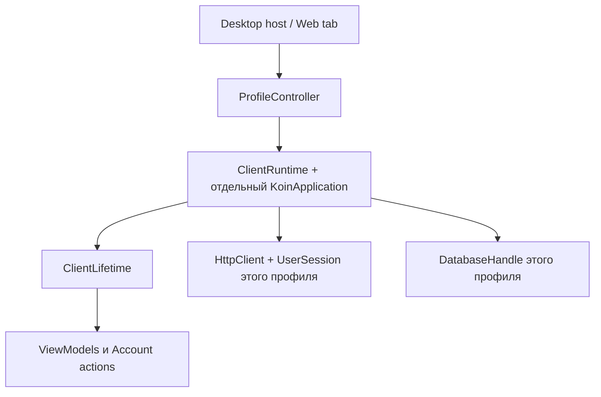

# Локальные библиотеки и аккаунты

В **Account** можно создать именованную библиотеку и выбрать её в **Libraries**.
Каждая библиотека имеет собственные SQLite, аудио, токен, очередь изменений и курсор sync.
Данные не переносятся автоматически при входе в другой аккаунт или переключении библиотеки.
Для второго аккаунта создайте отдельную библиотеку и войдите в неё.

## Гостевые слова

Если библиотека содержит гостевые слова, Sign in / Create account сначала показывает
количество слов и ожидающих изменений и предлагает **Link and sign in**.
Cancel сохраняет гостевой режим и не отправляет запрос авторизации.
После подтверждения все сохранённые слова связываются с аккаунтом и попадают в очередь sync;
сами записи, контекст, SRS и аудио не удаляются и не копируются в чужую библиотеку.
Это связывание текущей библиотеки, а не создание второй гостевой копии.

Владение, стабильный `AccountId`, очередь слов и новый токен сохраняются одной транзакцией
после успешной авторизации. Серверный `AccountId` проверяется и при повторном входе:
пересозданный на сервере аккаунт с прежним email не получает старый локальный словарь автоматически.
Sign out удаляет токен, сохраняя привязку владельца и данные. Другой аккаунт в эту библиотеку
войти не может; выбор другой библиотеки заменяет прежнюю общую блокировку multi-account.

Backend теперь выдаёт JWT с `sub=AccountId`, проверяет существование этого ID и выполняет
sync по нему. Старый токен удалённого аккаунта не авторизует новый аккаунт с тем же email.
После обновления backend токены прежнего формата без `sub` требуют повторного входа:
в Account выполните Sign out и войдите в ту же библиотеку. Словарь и SRS сохраняются.

Старый JWT может восстановить email владельца существующей библиотеки; это локальная
миграция метаданных, сервер по-прежнему проверяет подлинность JWT.
Если у старой БД есть sync cursor, но владелец неизвестен, она не считается гостевой и
не привязывается автоматически даже после обычного гостевого подтверждения. Нужен отдельный
сценарий восстановления исходного аккаунта; данные сохраняются.

Без токена приложение не запускает автоматический sync. Ошибка sync оставляет локальную
очередь и курсор на месте, HTTP/JSON-ошибки не выводят в UI внутренности Ktor.

## Desktop и TUI

Корень — `LANGKRAFT_DATA_DIR` или исторический `~/.langkraft`.

```text
<root>/
  langkraft.db, audio/, download-locks/     # Default library, прежние пути
  profiles.json, profiles.lock             # реестр и выбранная библиотека
  profiles/local-<uuid>/
    langkraft.db
    audio/
    download-locks/
```

Реестр версионирован, записи заменяются через временный файл, операции защищены file lock
между процессами. Повреждённый/неизвестный реестр не перезаписывается автоматически.
Идентификаторы генерируются приложением; пользовательское имя не используется в файловом пути.
Историческая Default library не переносится и не очищается.

Desktop переключается без перезапуска процесса и запоминает выбор. TUI использует этот же
реестр; выбор можно задать перед запуском:

```powershell
./gradlew.bat :shared:runTui --args='--list-profiles'
./gradlew.bat :shared:runTui --args='--create-profile=Work'
# Подставить идентификатор из предыдущей команды:
./gradlew.bat :shared:runTui --args='--profile=local-<uuid>'
./gradlew.bat :shared:runTui --args='--profile=default'
```

Создание через CLI выводит идентификатор и завершается; --profile сохраняет выбор и запускает TUI.
Авторизация и диалог привязки доступны в Compose Account, отдельной формы входа в TUI нет.

## Web

Default library сохраняет прежний URL и имена IndexedDB.
Именованные библиотеки открываются по `?profile=local-<uuid>` с отдельными SQLite/audio DB.
URL — выбор конкретной вкладки; переключение одной вкладки не меняет другие.
Существующие `recovered-*` URL остаются совместимыми, активные v2-копии также видны в выборе.

Для новых библиотек используются тот же registry/lifetime lease и Web Locks, что для v2 recovery.
Без Web Locks прежняя библиотека остаётся доступной, создание новых защищённых библиотек
возвращает ошибку. Переключение завершает текущий runtime, затем перезагружает страницу
с новым URL. После перезагрузки сохраняется выбранная в URL библиотека.

## Владение ресурсами



Сначала runtime отменяет запросы/VM и освобождает player, затем дожидается дочерних jobs,
включая NonCancellable-компенсацию загрузок, закрывает HTTP client и только потом SQLite.
Клиенты и репозитории захватывают свою сессию/БД; старый ответ не переключается на новый
контейнер через global Koin. Compose получает Koin через CompositionLocal, onCleared идемпотентен.
При возврате создаётся новый runtime той же сохранённой библиотеки.

## Проверки и границы

- `AccountProfilesTest`: настоящий Ktor/JWT, гостевое связывание, A → B → A с разными
  cursor/queue, отказ для JWT без subject и старого токена после пересоздания аккаунта.
- `JvmLocalProfileStoreTest`: SQLite/audio isolation, перезапуск реестра, конкурентные записи и повреждённые метаданные.
- `ClientLifetimeTest`/`ClientRuntimeTest`: ожидание старой компенсации и независимые контейнеры DI.
- `UserSessionTest`: согласие гостя, защита неизвестной истории и проверка стабильного AccountId.
- `npm test`: независимые Web SQL/session/cursor/audio и прежние recovery-сценарии.
- `npm run test:app`: Compose Account создаёт библиотеки, переключает A → B → A, отменяет
  привязку без auth-запроса и после подтверждения сохраняет слово и синхронизирует его.

Android target по-прежнему отключён и не проверялся. Переименование и удаление обычных
именованных библиотек не добавлены. Профили обеспечивают разделение данных приложения,
не шифрование или изоляцию от владельца ОС/browser origin.
