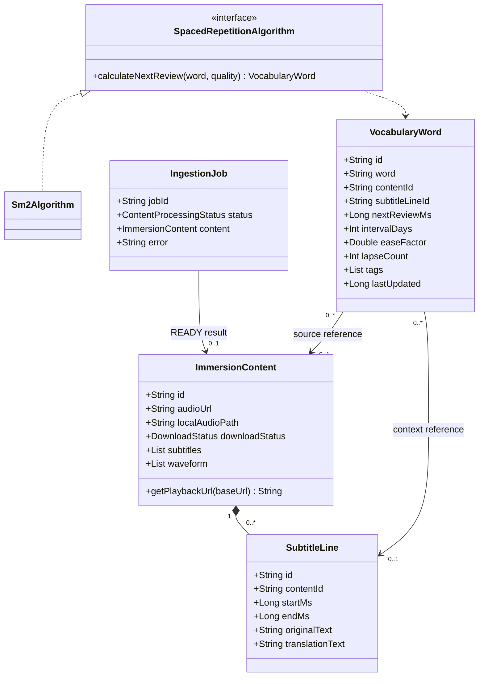
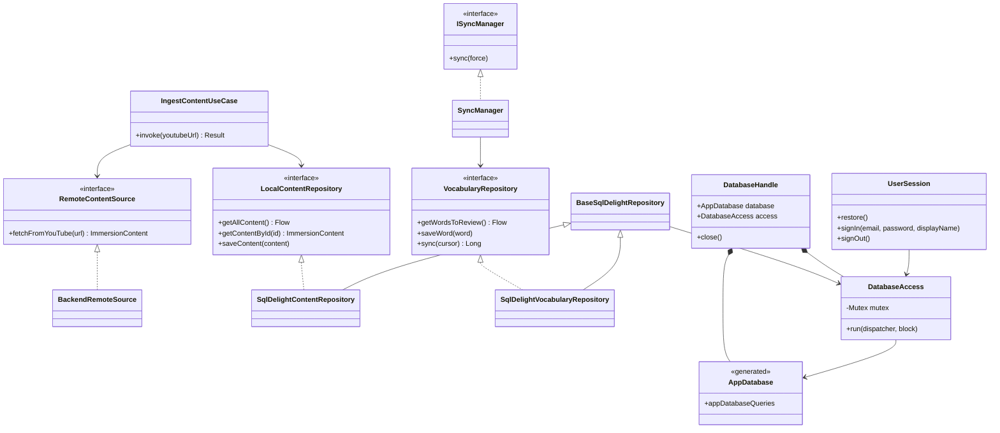
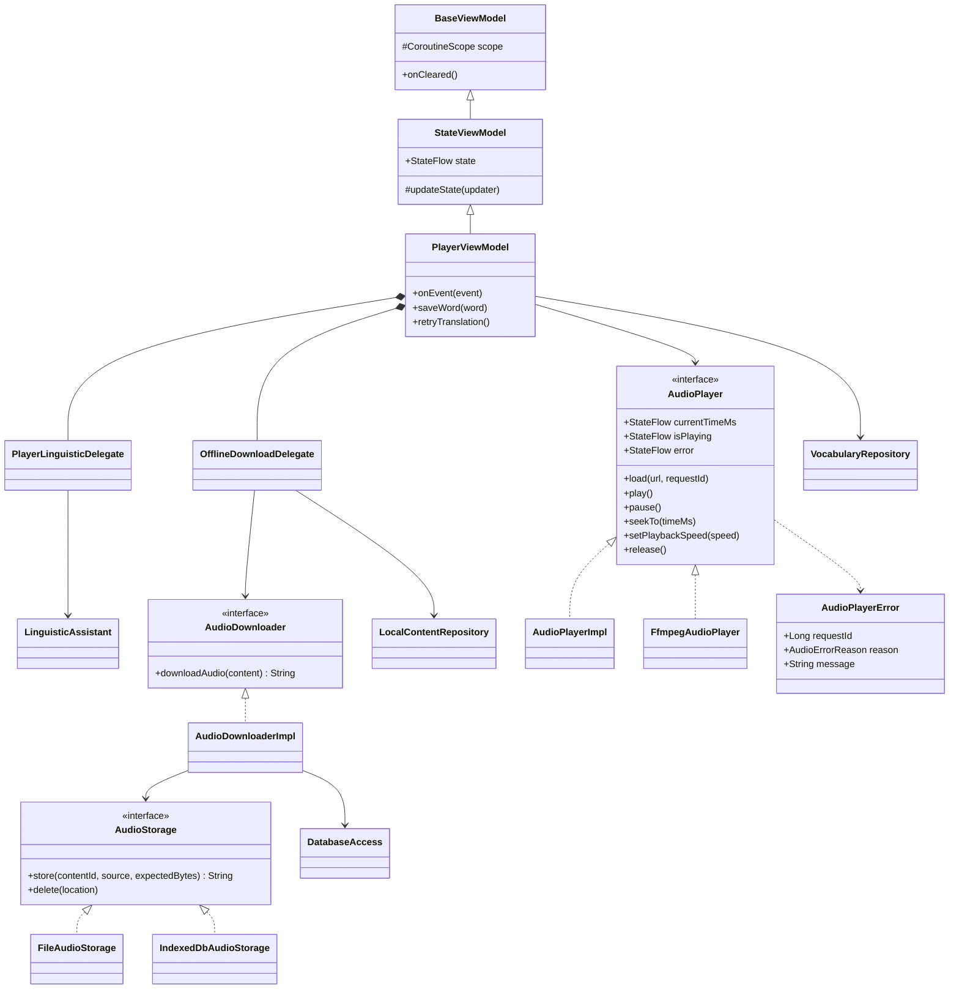
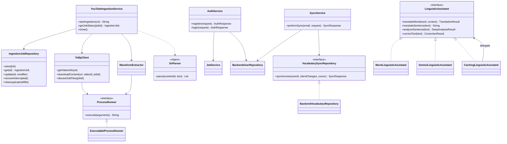

# UML классов Langkraft

Актуальная карта основных классов; вспомогательные UI-компоненты и все поля DTO опущены. Пунктир — использование, сплошная стрелка — удерживаемая зависимость, треугольник — наследование/реализация. `MainApp`, Koin DSL и Routing — функции, поэтому они описаны в [руководстве](DEVELOPER_GUIDE.md), а не выданы за классы. Mermaid отображается на GitHub; исходники диаграмм находятся в этом Markdown.

## Модели и SRS

Ссылки VocabularyWord nullable. На устройстве без соответствующего видео оригинальные source IDs хранятся в metadata до импорта. Коллекция subtitles принадлежит content; удаление SQL cue обнуляет его ссылку в словаре. **Strategy** — SpacedRepetitionAlgorithm/Sm2Algorithm.

Исходники: [Models.kt](../shared/src/commonMain/kotlin/com/langkraft/domain/model/Models.kt), [SrsEngine.kt](../shared/src/commonMain/kotlin/com/langkraft/domain/srs/SrsEngine.kt).

## Клиент: use case, repositories и БД

SQLDelight repositories реализуют **Repository**; BackendRemoteSource адаптирует HTTP. DatabaseHandle владеет driver, AppDatabase и единым access; DatabaseAccess сериализует обращения, а не создаёт отдельную БД для каждого repository. Диаграмма показывает композицию объектов приложения, не отдельные Gradle-модули.

Исходники: [Repositories.kt](../shared/src/commonMain/kotlin/com/langkraft/domain/repository/Repositories.kt), [data/repository](../shared/src/commonMain/kotlin/com/langkraft/data/repository), [data/database](../shared/src/commonMain/kotlin/com/langkraft/data/database), [data/sync](../shared/src/commonMain/kotlin/com/langkraft/data/sync).

## Player и владение offline-аудио

StateViewModel в коде generic `StateViewModel<S>`; Player использует PlayerState. AudioPlayerImpl — expect/actual с реализациями Web HTMLAudioElement и Desktop VLC; FfmpegAudioPlayer — JVM реализация на ffplay. Koin выбирает движок, исходники Android сохранены вне активной сборки. AudioPlayer/AudioStorage — платформенные порты и адаптеры. UI — **Presentation Model/MVVM**, делегаты разделяют операции, StateFlow — **Observer**.

Для LK-02 важны три владельца: storage до возврата location → downloader до SQL link → БД после link. Компенсация удаляет только новый объект без SQL-ссылок. В Web JS-модуль storage удерживает Web Lock на незавершённую загрузку; recoverIncompleteAudio удаляет manifest/chunks нового формата только при свободном lock. Запуск — WebDatabaseFactory и beginAudio. Готовые, legacy и no-lock объекты сохраняются; SQL recovery после аварии остаётся отдельной задачей. Связи с браузерными API показаны в [UML-ченджлоге REL-01](CHANGELOG_UML.md).

Исходники: [ui/player](../shared/src/commonMain/kotlin/com/langkraft/ui/player), [AudioPlayer.kt](../shared/src/commonMain/kotlin/com/langkraft/audio/AudioPlayer.kt), [AudioStorage.kt](../shared/src/commonMain/kotlin/com/langkraft/data/audio/AudioStorage.kt), [AudioDownloaderImpl.kt](../shared/src/commonMain/kotlin/com/langkraft/data/repository/AudioDownloaderImpl.kt).

## Backend: ingestion, auth, sync и AI

ProcessRunner — порт внешнего процесса, ExecutableProcessRunner — **Adapter** к ProcessBuilder с timeout/cleanup. IngestionService использует Channel и workers (**Producer–Consumer**). Cache — **Decorator**, AI-провайдеры — **Strategy**. Client commonModule выбирает mock, backendModule — обёрнутый кэшем Gemini/mock; это разные экземпляры/графы DI. Exposed Database удерживается backend repositories, SQLDelight AppDatabase к серверной БД не применяется.

Исходники: [backend](../backend/src/main/kotlin/com/langkraft/backend), [backend/ai](../backend/src/main/kotlin/com/langkraft/backend/ai), [backend/db](../backend/src/main/kotlin/com/langkraft/backend/db). Полный каталог паттернов, модулей и правил изменения — [DEVELOPER_GUIDE](DEVELOPER_GUIDE.md).
