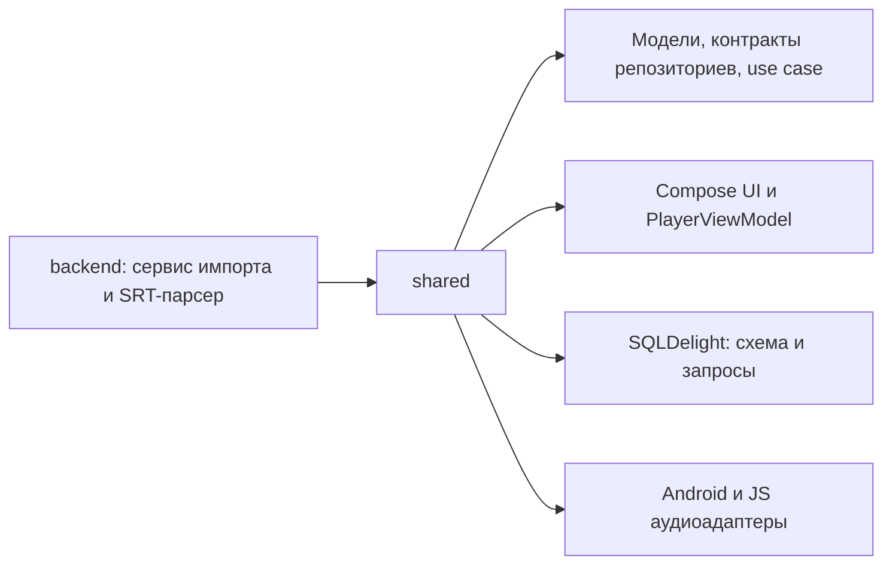

# Анализ Langkraft

Дата: 2026-10-11. Область: все отслеживаемые исходники, конфигурация сборки, SQLDelight и документация.

Вердикт: нужна доработка перед запуском MVP. Это каркас приложения: модели, интерфейсы репозиториев, схема БД, UI и платформенные аудиоадаптеры существуют, но сквозной пользовательский сценарий ещё не собран.

## Gitignore

Добавлены правила для `.gradle/`, `.kotlin/`, `build/` во всех модулях, `out/`, `.idea/`, `*.iml`, `local.properties`, `.env`, локальных ключей, служебных файлов ОС и каталогов загруженного медиа. Шаблоны `.env.example` / `.env.sample` и будущий `gradle/wrapper/gradle-wrapper.jar` разрешены.

Проверка `git check-ignore --no-index -v` подтвердила правила и исключения. Исходники не игнорируются.

В индексе уже находятся 11 служебных файлов: 9 из `.gradle/`, `.idea/.gitignore` и `build/reports/problems/problems-report.html`. `.gitignore` не прекращает отслеживание существующих файлов. Индекс в рамках анализа не менялся; для отдельной уборки можно выполнить `git rm -r --cached -- .gradle .idea build`, сохранив файлы на диске. До проверки уже были локальные изменения в Gradle-кеше и отчёте сборки.

## Архитектура и фактическая готовность

Модели и интерфейсы создают полезные границы, но реализации ContentRepository / VocabularyRepository, создание SQL-драйверов, HTTP-клиент импорта и связывание компонентов отсутствуют. В backend нет точки входа Ktor, маршрутов импорта или выдачи медиа. Объявленные `androidApp` и `webApp` отсутствуют на диске. Тестов и CI в репозитории нет.

Для текущего объёма разумно сохранить два модуля и закончить один работающий сценарий. Backend сейчас зависит от всего shared ради моделей, включая его UI и платформенные ограничения. После восстановления сборки можно выделить модели и API-контракты в небольшой независимый модуль, если эта зависимость продолжит мешать серверной сборке.

## Блокеры

1. **Конфигурация сборки неполная.** `shared/build.gradle.kts:8` объявляет Android target, но Android Gradle Plugin не применён и блока `android` с namespace / compileSdk нет. `settings.gradle.kts:4` и `:5` включают отсутствующие приложения; задачи запуска из README не реализованы. Gradle Wrapper отсутствует. Сначала требуется восстановить конфигурацию и воспроизводимый способ запуска.

2. **Нарушен контракт expect/actual.** `shared/src/commonMain/kotlin/com/langkraft/audio/AudioPlayer.kt:16` ожидает конструктор без аргументов, а Android actual в `shared/src/androidMain/kotlin/com/langkraft/audio/AudioPlayerImpl.kt:16` требует Context. Для `jvm("desktop")` actual вообще отсутствует. Требуется платформенная фабрика или согласованный механизм передачи зависимостей; desktop нужно реализовать либо убрать из целей MVP.

3. **JVM API находится в commonMain.** `shared/src/commonMain/kotlin/com/langkraft/ui/player/WordDetailsSheet.kt:11` импортирует `java.util.UUID`, недоступный в общем коде для JS. Генерацию ID следует перенести в платформенный адаптер или использовать совместимое с выбранной версией Kotlin общее решение.

4. **Не подключена библиотека импорта.** В `backend/src/main/kotlin/com/langkraft/backend/YouTubeIngestionService.kt:4` и `:5` есть импорты YtdlpJava; соответствующая зависимость в `backend/build.gradle.kts:14` закомментирована. Требуется подключить конкретный артефакт и проверить его API. Наличие yt-dlp в системе само по себе не разрешает Kotlin-импорты.

5. **Управление UI не управляет аудио.** `PlayerViewModel.kt:28` и `:31` изменяют только состояние. ViewModel не получает AudioPlayer, не вызывает load/play/pause/seekTo и не собирает его StateFlow. Поэтому PLAY и переход по субтитрам меняют отображение, но не воспроизведение. Нужно внедрить плеер и связать его реальное состояние с UI, включая освобождение ресурсов.

## Существенные проблемы

6. **Неполный контракт медиа.** `YouTubeIngestionService.kt:42` ожидает `.opus`, но `:56` возвращает URL `.mp3`; маршрут выдачи файла отсутствует. Название и длительность остаются заглушками (`:55`, `:59`). Нужно согласовать формат файла и URL, реализовать выдачу медиа и получение метаданных.

7. **REPLACE может уничтожить связанные данные.** В `shared/src/commonMain/sqldelight/com/langkraft/db/AppDatabase.sq:49` используется `INSERT OR REPLACE` для Content. В SQLite REPLACE удаляет конфликтующую строку перед вставкой; при включённых внешних ключах это активирует `ON DELETE CASCADE` для субтитров и `SET NULL` для ссылок словаря. Вывод о риске следует из сочетания запроса и схемы: второй saveContent в `IngestContentUseCase.kt:25` может затронуть уже сохранённые связи. В `AppDatabase.sq:60` замена Vocabulary также сбрасывает не включённые в INSERT поля SRS к значениям по умолчанию. Нужны UPDATE или поддерживаемый выбранным SQLDelight upsert и транзакция сохранения контента с субтитрами. Семантика подтверждена документацией [SQLite REPLACE](https://www.sqlite.org/lang_conflict.html) и [внешних ключей](https://www.sqlite.org/foreignkeys.html).

8. **Панель слова не включена в экран.** WordDetailsSheet существует, но `ImmersionPlayerView.kt` её не вызывает. Клик обновляет selectedWord и запускает перевод, однако пользователь не получает панель перевода и кнопку сохранения. Нужно показать панель по состоянию, связать dismiss/save и явно отобразить ошибки.

9. **Гонки перевода и необработанные исключения.** `PlayerViewModel.kt:43` запускает новый запрос на каждый клик без отмены предыдущего. Если ответ для A приходит после ответа для B, перевод A оказывается у выбранного B. Старый перевод не очищается при новом запросе. При исключениях loadContent/translate/saveWord состояние загрузки не восстанавливается; поле error не заполняется. Нужны отмена или идентификатор актуального запроса и обработка ошибок с сохранением отмены корутин.

10. **Парсер падает на оборванном SRT.** `backend/src/main/kotlin/com/langkraft/backend/SrtParser.kt:20` увеличивает индекс без проверки границ; `:23` читает следующую строку, `:25` предполагает наличие второй части временного диапазона. Например, вход `"1"` выходит за границы списка. Нужны проверка структуры блока, времени начала/конца и понятная ошибка; тесты должны покрывать корректный многострочный SRT, CRLF, BOM и оборванные блоки.

11. **Отмена импорта превращается в обычную ошибку.** `IngestContentUseCase.kt:13` использует runCatching вокруг suspend-вызовов и ловит CancellationException вместе с остальными исключениями. Отмену нужно пробрасывать. Загрузка аудио на `:21` выполняется последовательно, хотя комментарий обещает фоновую работу; контракт должен явно определять завершённый импорт либо отдельное состояние скачивания и повторную попытку.

## Дополнительные замечания

- `ImmersionPlayerView.kt:91` выводит все слова в один Row без переноса: длинные предложения выходят за ширину экрана. Подойдёт переносимый FlowRow или текст с аннотациями кликабельных диапазонов.
- Интервалы подсветки используют включённую верхнюю границу (`ImmersionPlayerView.kt:28`, `:59`): соседние реплики на общей границе могут подсвечиваться одновременно. Следует определить семантику `[startMs, endMs)`.
- README считает первую фазу завершённой, PROJECT_CONTEXT описывает сохранение слов как реализованное, но обязательные интеграции отсутствуют. Документацию нужно привести к фактическому состоянию после первого рабочего запуска.

## Порядок дальнейшей работы

1. Восстановить Gradle Wrapper, Android-конфигурацию и приложения; устранить блокеры компиляции, определить цели Android/Web/Desktop.
2. Добавить SQLDelight-драйверы и реализации репозиториев; проверить обновление Content без потери субтитров и сохранение SRS.
3. Связать AudioPlayer, PlayerViewModel и панель слова; пройти сценарий на локальном тестовом аудио без зависимости от YouTube.
4. Завершить Ktor API и импорт: зависимость YtdlpJava, согласованный медиа-URL, метаданные, обработка ошибок и очистка неудачных загрузок.
5. Добавить тесты SRT, состояния плеера, гонок переводов, отмены импорта, SQL-связей и API; затем CI и обновление README.

## Границы проверки

Выполнен статический анализ всех имеющихся исходников, сверка документации со структурой проекта и проверка правил игнорирования через Git. Изменения ограничены `.gitignore` и этим отчётом; код приложения и Git-индекс не менялись.

Сборка и тесты не запускались: в проекте нет Wrapper, gradle не доступен в PATH, конфигурация имеет перечисленные статические блокеры, тестовые исходники отсутствуют. Найденные ошибки сборки следует подтвердить компиляцией после восстановления инструментария; runtime-поведение не проверялось.
